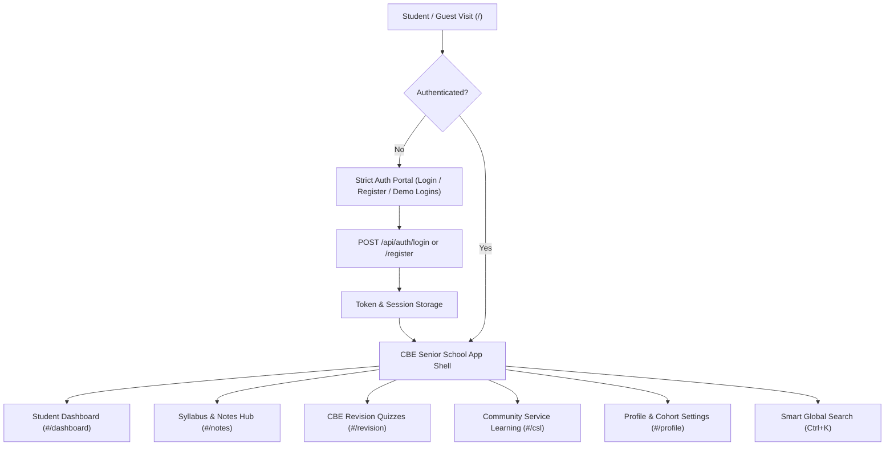
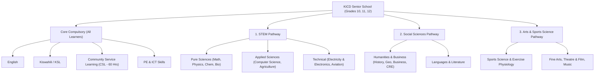

# CBE Senior School: Kenyan CBE Learning Platform (Grades 10–12)

> [!NOTE]
> **Live Local Application**: Running on `http://localhost:3000`  
> **Project Directory**: `C:\Users\ADMIN\.gemini\antigravity\scratch\cbe-senior-school`

---

## 1. System Architecture Overview

---

## 2. KICD Senior School Curriculum Architecture

---

## 3. Key Components & Implementation

| Component | File Link | Purpose & Capabilities |
| :--- | :--- | :--- |
| **REST Server & SPA Engine** | [server.js](file:///C:/Users/ADMIN/.gemini/antigravity/scratch/cbe-senior-school/server.js) | Pure Node.js HTTP server, password hashing, sessions, REST API, SPA static fallback |
| **Strict Auth Portal** | [auth.js](file:///C:/Users/ADMIN/.gemini/antigravity/scratch/cbe-senior-school/public/js/auth.js) | Full-screen entry gate, remember-me token handling, demo logins, form validation |
| **Curriculum Database** | [curriculum-data.js](file:///C:/Users/ADMIN/.gemini/antigravity/scratch/cbe-senior-school/public/js/curriculum-data.js) | Complete KICD lesson notes (SLOs, KIQs, Core Competencies, PCIs, Worked Examples) |
| **Student Dashboard** | [dashboard.js](file:///C:/Users/ADMIN/.gemini/antigravity/scratch/cbe-senior-school/public/js/dashboard.js) | Personalized greeting, progress bars per subject, continue reading hero card |
| **Rich Notes Reader** | [notes-reader.js](file:///C:/Users/ADMIN/.gemini/antigravity/scratch/cbe-senior-school/public/js/notes-reader.js) | Hierarchical tree navigator, text highlighter, sticky notes, dark/sepia mode, print to PDF |
| **Revision & Quiz Hub** | [quiz-hub.js](file:///C:/Users/ADMIN/.gemini/antigravity/scratch/cbe-senior-school/public/js/quiz-hub.js) | Timed assessments with official KNEC 4-tier rubric evaluation (Level 1 to Level 4) |
| **CSL Portal** | [csl-hub.js](file:///C:/Users/ADMIN/.gemini/antigravity/scratch/cbe-senior-school/public/js/csl-hub.js) | 60-Hour Community Service Learning logger, supervisor sign-offs, reflection log |
| **Profile & Settings** | [profile.js](file:///C:/Users/ADMIN/.gemini/antigravity/scratch/cbe-senior-school/public/js/profile.js) | Grade transition (Grade 10 &rarr; 11 &rarr; 12), pathway switching, bookmarks library |
| **Smart Search** | [search-modal.js](file:///C:/Users/ADMIN/.gemini/antigravity/scratch/cbe-senior-school/public/js/search-modal.js) | Real-time global search with keyboard shortcut `Ctrl+K` |
| **Theme & Typography** | [style.css](file:///C:/Users/ADMIN/.gemini/antigravity/scratch/cbe-senior-school/public/css/style.css) | Oceanic royal blues, electric cyan accents, glassmorphic cards, printable styling |

---

## 4. Pre-Seeded Student Accounts

All accounts use the password `cbe2026`:
1. **Achieng Onyango** (`achieng@cbe.ke`): Grade 11 &bull; STEM Pathway (Alliance Girls High School)
2. **Brian Mwangi** (`mwangi@cbe.ke`): Grade 10 &bull; Social Sciences Pathway (Mangu High School)
3. **Faith Chebet** (`chebet@cbe.ke`): Grade 12 &bull; Arts & Sports Science Pathway (Kapsabet Girls)
